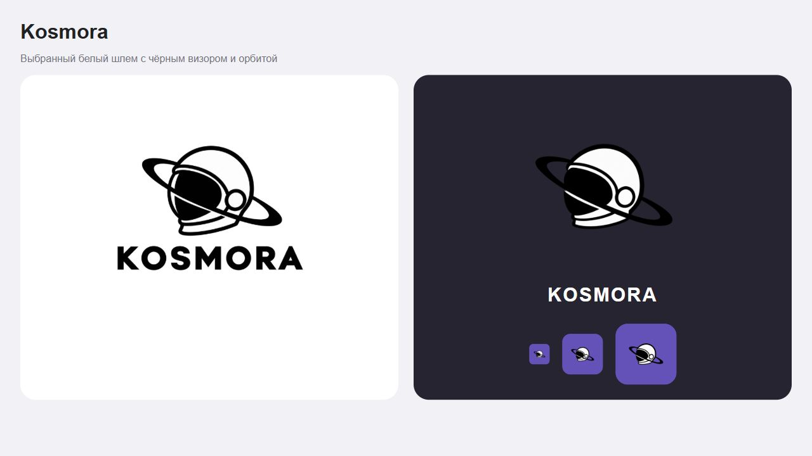

# Kosmora — выбранное имя и знак

Владелец 7 октября 2026 выбрал первый вариант из четырёх доработок шлема:
белый купол с чёрным визором, контуром и наклонной орбитой. Одновременно
утверждено написание **Kosmora**, в логотипе **KOSMORA**.

Обновлены все пользовательские названия в web-чате, Studio, Manager, настройках,
GitHub, странице входа, PWA и Windows-клиенте. Экспорты получают префикс
`kosmora-`, новые подготовленные GitHub-ветки — `kosmora/change-`.
Системные промпты обычного чата и Manager используют новое имя.

Исходный знак и надпись находятся в `assets/brand`. Прозрачные PNG получены
встроенным image_gen; белые области шлема непрозрачны. SVG-представления
в интерфейсе и Windows содержат PNG, а не заявляются векторной трассировкой.
Общие иконки создаёт `scripts/render-brand-assets.mjs`; его `--check` сравнивает
сгенерированные файлы с исходным знаком. Web-иконка имеет размер 512×512,
Apple — 180×180, Windows ICO содержит семь размеров от 16 до 256.

Идентификаторы хранения, cookie, сессий, переменные окружения, пакетный scope,
Windows appId и папка профиля сохранены для совместимости. Переименование не
требует переноса базы, смены ключей или сброса черновиков. Windows-версия — 0.10.0.

Старые изображения и спецификации с предыдущим написанием являются историей
этого же проекта. Настоящий документ фиксирует решение владельца; серверный
выпуск и установка Windows подтверждаются отдельными записями приёмки.
