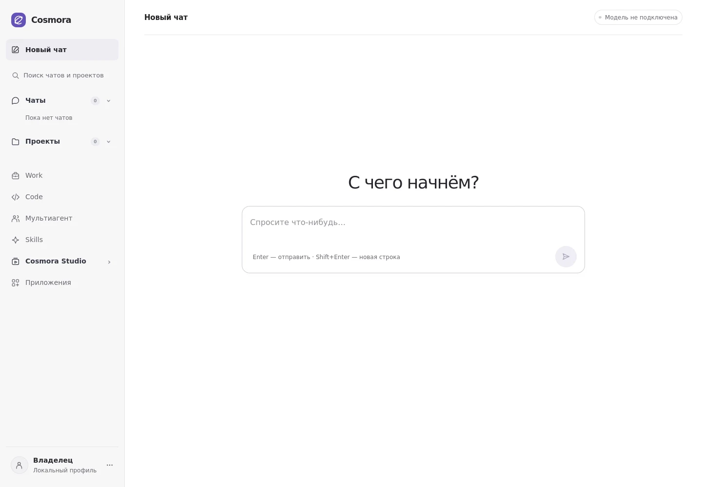
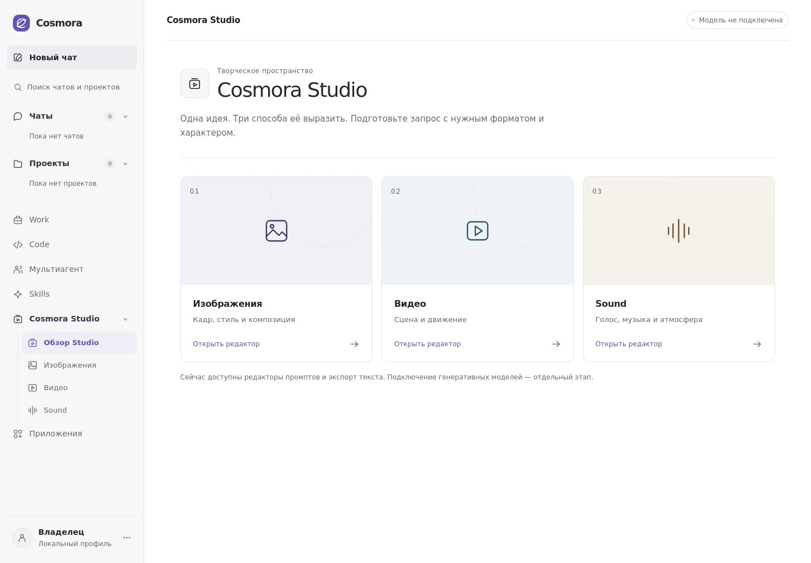

# Cosmora: интерфейсы рабочих разделов

Продолжение draft PR #262. Основной поток чата и API не изменяются.

## Карта экранов

| Экран           | Основное действие             | Дополнительные сценарии                                                                  |
| --------------- | ----------------------------- | ---------------------------------------------------------------------------------------- |
| Чат             | Отправить сообщение           | Поиск истории в боковой панели, переход к проекту через существующее подтверждение       |
| Work            | Открыть проект                | Поиск, текущие/архив, план и контекст, начало нового черновика                           |
| Code            | Сформировать задание для чата | Тип задачи, критерии готовности, восстановление черновика вкладки                        |
| Мультиагент     | Перейти в Agent Studio        | Объяснение ролей Manager / исполнителя / Критика, разрешения проекта                     |
| Skills          | Просмотреть каталог           | Настройка функций команды, просмотр разрешений                                           |
| Cosmora Studio  | Выбрать вид материала         | Отдельные редакторы изображения, видео и аудио                                           |
| Редактор Studio | Подготовить промпт            | Формат, стиль, пример, копирование, скачивание текста                                    |
| Приложения      | Открыть GitHub preview        | Поиск и фильтр доступных предпросмотров, явные статусы будущих интеграций                |
| Настройки       | Изменить внешний вид          | Размер текста, плотность навигации, диагностика модели, переход к автономности и команде |
| Возможности     | Посмотреть карту продукта     | Поиск и фильтр планируемых функций, требования для запуска, переходы к текущим разделам  |

## Навигация и состояния

- На компьютере: история, проекты, Work → Code → Мультиагент, Skills,
  раскрываемая папка Studio и приложения. Аккаунт находится внизу панели.
- На телефоне: Новый чат, Work, Code, Studio, Ещё. Модальное меню содержит все
  разделы, последние чаты, проекты и настройки; Escape закрывает меню.
- Поиск в боковой панели раскрывает свёрнутые списки чатов и проектов, учитывает
  пробелы по краям и регистр. Кнопка очистки возвращает фокус в строку.
- В мобильном меню поиск охватывает всю историю чатов и проектов, включая записи
  за пределами шести последних. Escape сначала очищает запрос, затем закрывает меню.
- Меню владельца — доступный с клавиатуры disclosure. Закрывается по Escape,
  клику снаружи или выбору пункта. Escape возвращает фокус владельцу.
- Work различает загрузку, ошибку, отсутствие проектов и пустой результат поиска.
- Перенос задания из Code или Work заполняет новый черновик и фокусирует редактор.
  Сообщение не отправляется автоматически.
- Формат аудио по умолчанию — «Короткий». Параметры включаются в итоговый текст.
  Любое редактирование сбрасывает устаревший результат.
- Черновики Studio изолированы по типу материала. Code и Studio используют
  sessionStorage этой вкладки, ограничивают длину текста и проверяют сохранённые
  значения. Ошибка хранилища не препятствует работе формы.
- Локальные настройки интерфейса содержат только два boolean-параметра. Они не
  меняют полномочия агентов или серверный профиль автономности.
- URL `?surface=studio` и `?surface=features` открывает соответствующий экран;
  переход между рабочими областями обновляет ссылку, пригодную для передачи.
- Первый клик по свёрнутой папке Studio открывает обзор и раскрывает редакторы.

## Карта будущих возможностей

`workspace-capabilities.ts` хранит описания десяти запланированных функций по
работе, творчеству, команде и платформе. Экран «Возможности» отделяет доступные
сейчас разделы от требований для следующих этапов. Раскрытие карточки показывает
конкретные зависимости; карточка не запускает и не включает функцию. Среди
зафиксированных правил: согласие на необратимый перевод чата в Work, наследование
автономности проекта, приоритет главного владельца в коллективной работе и
валидация противоречий для Custom-профиля. Этот каталог — интерфейсный контракт,
а не реализация доступа, платежей, моделей или совместной работы.

## Фактические ограничения

- Studio готовит текст: генерация изображений, видео и звука не подключена.
- Code готовит задание: редактор репозитория, выполнение кода и публикация не подключены.
- GitHub preview использует демонстрационные данные; OAuth и операции записи не выполняются.
- Google Drive и Telegram обозначены как запланированные, без неработающих кнопок подключения.
- Схема ролей не показывает вымышленных активных агентов. Настройка направляет в существующий Agent Studio.
- Авторизация пользователей, коллективные чаты и публикация навыков остаются отдельной работой.

## Визуальная система — 27 сентября

- Общие цвета, поверхности и семантические состояния заданы в `globals.css`.
  Основной текст — графитовый, фиолетовый используется для активных пунктов,
  основных действий и фокуса. Ошибки, предупреждения и успешные действия
  сохраняют отдельные цвета и текстовые обозначения.
- Основной текст — 15–16 px; подписи обновлённых разделов — не менее 12 px.
  Заголовки используют спокойную шкалу размеров и среднее начертание.
- Убраны декоративные градиенты и тяжёлые тени. Studio различает типы материалов
  тремя приглушёнными поверхностями. Вспомогательные пояснения не конкурируют с формами.
- Agent Studio, Control Center, Skills, GitHub, состояние модели, контекст проекта
  и выполнение Manager согласованы с основной светлой рабочей областью.
- Формы имеют видимый клавиатурный фокус. Сенсорные элементы основных редакторов
  увеличены до 44 px; поддерживается системное сокращение анимаций.
- История в боковой панели показывает названия, без повторения текста последнего ответа.
  Строки не сжимаются и не накладываются при заполненном списке.
- Индикатор настройки провайдера учитывает наличие конфигурации credentials;
  отсутствие подключения больше не сопровождается зелёной точкой.
- Форма чата отключает браузерное автоматическое восстановление состояния полей,
  чтобы Firefox не восстанавливал устаревший `disabled` перед гидратацией React.

## Проверка

В Firefox проверены 23 существующих E2E-сценария: основные разделы и мобильная
навигация, клавиатурный фокус, настройки, повреждённые сохранённые значения,
экспорт и восстановление Studio, Code → чат, Agent Studio, Control Center,
создание и скачивание mock-файлов Manager, мобильный план Manager.
Исправлены неоднозначные тестовые локаторы; проверки поведения и запрет
неожиданных запросов записи сохранены.

Дополнительно проверены реальные скриншоты чата, Code, Work, Studio, приложений
и мобильного меню. Для Agent Studio, Control Center, Skills, GitHub и состояния
модели проверено отсутствие горизонтального переполнения при ширинах
320, 390, 768 и 1440 px. Базовые пары текста и фона новой палитры имеют
расчётный контраст не ниже 5.2:1; это не полный аудит WCAG.

Для дополнения «Возможности» пройдены ESLint, TypeScript и отдельная статическая
сборка Next. Повторный запуск браузерных сценариев в этой среде блокирует
`SIGBUS` при старте Firefox; загрузка Chromium возвращает повреждённый архив.
Новые сценарии поиска, раскрытия требований и прямых ссылок добавлены в E2E,
но их зелёный результат на этом этапе не заявляется. Тесты используют локальные
mock-данные; платные модели не вызываются.

Снимки ниже показывают настоящую локальную сборку с пустой историей:

